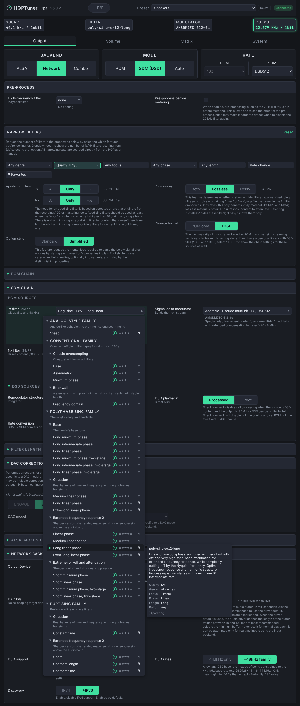
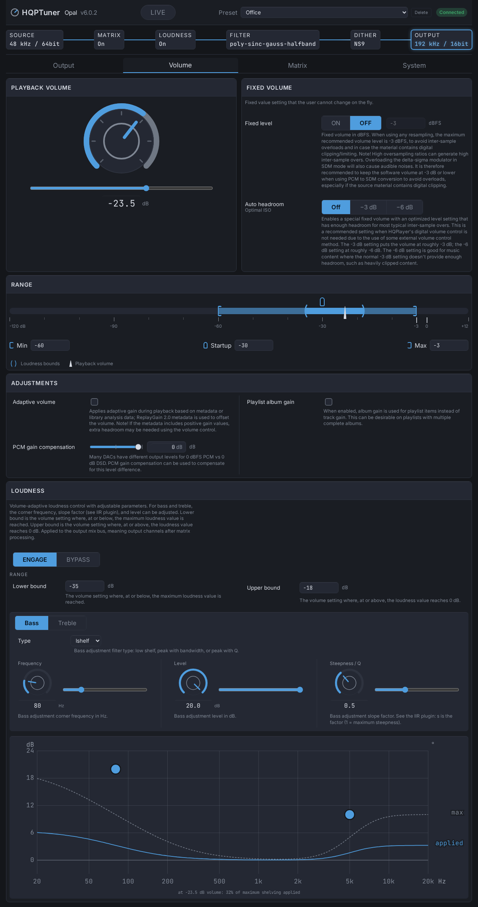
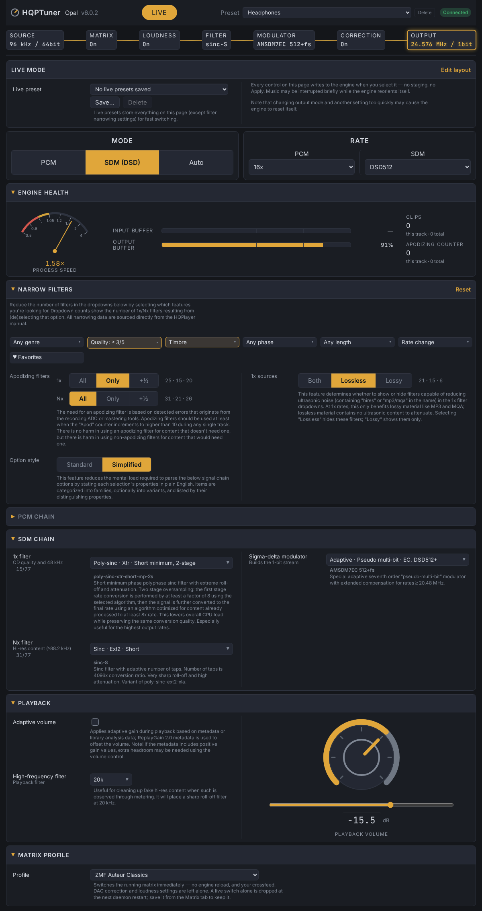

# HQPTuner: an improved configuration interface for HQPlayer Embedded

An enhanced configuration interface for HQPlayer Embedded.

[Discord](https://discord.gg/9ncNefPXnV)



*The Output tab, upsampling a CD-quality file to DSD512 using the poly-sinc-ext2-long filter. The filter list is shown expanded in Simplified mode, converting the list of confusing filter shorthand into plain English. The list has also been narrowed to only show apodizing filters rated 3/5 or greater quality.*

## Inspiration

HQPlayer is, in my humble opinion, the best deal in all of high-end digital audio, with two caveats:
1. Hitting the highest rates requires significant expenditure on hardware that is not getting any cheaper.
2. The minimalist, brtutalist UI makes learning and using the program more difficult than it needs to be.

The second point is the inspiration for HQPTuner: where the stock UI expects users to arrive with a full understanding of the features and their settings by reading and re-reading the manual, HQPTuner instead puts the manual's knowledge where the decision is being made: in the UI, next to the feature.

HQPTuner also adds a ton of convenience features as well! Let's take filter narrowing as an example: this is one of HQPTuner's flagship features and I think the one thing most badly missing from the default UI.

The web interface presents you with four dropdowns: 1x and Nx filters for PCM and SDM, each populated by over 65 filters named in shorthand like `sinc-MGa`, `IIR2`, and `poly-sinc-xtr-short-mp-2s`. To select one, you open the manual, do your best to parse the descriptions (if you even know what any of the jargon means), find one that seems appropriate based on what you do know, and pick it out of the dropdown. If you're listening to Redbook content (16bit/44.1kHz), you might want an apodizing filter to correct for mastering errors. Which of the filters are apodizing? The interface won't tell you. There's a wealth of information in the manual, including which filters are apodizing, so you do your best to scroll through pages of filter tables to cross reference apodizing with something that fits your genre. From there, you're asked to decide between, say, `poly-sinc-ext2-xla`, `poly-sinc-gauss-xl`, `sinc-M`, `sinc-MG`, `sinc-Mx`, and others. How do you decide among them if you don't know what an "extended frequency response" is? What does "extreme roll-off and attenuation" imply? Roll-off of what? What's being attenuated? What on earth does "Gauss" or "half-band"—or "Gaussian half-band" for that matter—actually mean?

Filter science is a complex and nuanced topic that will take most people several passes to grasp… and none of it is required to use HQPTuner.

Here's the HQPTuner approach to selecting a filter:
1. **Easy Mode** offers a jargon-free way to select from among the best filters in the program, and a few curiosities as well. Start with The Perfect Ten, aka the program's defaults, which are genuinely amazing filters that work for all content.
2. If you're brave enough to face the jargon of the full filter list, HQPTuner's **Simplified options** mode translates HQPlayer's shorthand into plain English: filters are organized into families and classes with short descriptions of each, then separated by what makes a filter unique within its class. For example, `poly-sinc-gauss-long` becomes Polyphase sinc family, Gaussian class, Long linear phase. Yes, it's still filter jargon, but at least it's _legible_ filter jargon! Hold your mouse over a filter to see its full description and list of qualities from the manual.
3. Use the **Narrowing system** to cut the list down to only filters appropriate for your genre and tastes. Your list goes from 60+ to a handful in just a few clicks.
4. If you still can't decide, use the **Setting Switcher** in Live mode to try two filters side-by-side!
5. When you find a sound you love, store it as a Live Snapshot and/or use the Favorites toggle to save it for later.

In short, whether you're brand new to HQPlayer or an experienced user tired of the default UI, HQPTuner makes HQPlayer's configuration easier, more flexible, and better looking.

## Features and Improvements

HQPTuner offers the following features and improvements over the stock web configuration UI.

**1. Option names in plain English.** HQPTuner offers "Simplified" option types, converting the list of baffling filter shorthand like `poly-sinc-hb-xs-2s` into the "Extra-short two-stage option within the Half-band variants of the Polyphase Sinc filter family". Filters are sorted by family (Analog-style, Conventional, Polyphase Sinc, Interpolation, Pure Sinc, and Misc), optionally categorized by variant class (e.g., "Extreme roll-off and attenuation" or "Extended frequency response"), then by their distinguishing features within that class, e.g., phase and length. This makes it vastly simpler to parse the filter list into reasonable choices. Yes, those choices are still filter jargon, but at least it's legible filter jargon!

**2. Filter narrowing.** The manual's knowledge folded into the filter lists, so 80 opaque names narrow to the few that fit in a few clicks. Save the filters you keep coming back to with the Favorites toggle.

**3. Easy Mode.** Jargon-free filter selection. Nine curated presets, no prior knowledge required: pick one, nudge Emphasis toward Space or Transients, and hit Play. Tiles name and describe their filters, error correction levels, and relative resource consumption ("cost").


*Easy Mode, with the Lifelike preset selected. The Lossless/Lossy switch at the top swaps in filters optimized for lossy sources, and the Emphasis knob on a tile chooses between linear and minimum phase.*

**4. Headphone Auto EQ.** A built-in AutoEq library of 8850+ headphone models: search your headphones, A/B the correction curve against your current response, and load it into a stereo pipeline pair in one click. AutoEq/REW ParametricEQ text files import directly too, and every EQ band becomes a draggable dot on the live response plot. Tune by ear, REW-style.

**5. Crossfeed, two ways.** HQPlayer ships Bauer crossfeed: a three-preset model with a crossover frequency and a level in dB, which are coefficients of its own filter rather than anything you can picture. It's good, but it's not my jam. So I built in an alternative: structural crossfeed feature modeling an actual head and an actual pair of speakers, from Brown & Duda's structural HRTF model. Three controls, all quantities you can picture: **speaker angle**, **head circumference**, and **center character** (ok, the last one is hard to picture, but the plots make it easy to understand). It compiles to sixteen matrix pipelines carrying an explicit interaural delay and a head-shadow filter; the shadow filter factors exactly into a flat row plus a first-order lowpass, so nothing is numerically fitted and nothing is sample-rate-bound. Integrates with and doesn't disturb your EQ curve.

The above five features are my flagships, but the following benefits are offered as well:

* **Surface the manual's knowledge**: Every feature has its manual's description printed right underneath it. This can be converted to hover tips for those who prefer a cleaner interface.
* **More sensible organization**: Settings are organized into four tabs: Output, Volume, Matrix, and System. Stop wondering where to find a certain feature.
* **Easier rate selection**: No more memorizing raw Hz values: select, e.g., PCM 4x or DSD512 from the output rate menu.
* **Idiot proofing**: Only see options that are appropriate for the settings you're running. Don't waste time trying to figure out the best Integrator if you're only outputting PCM. Running DSD512? Modulators that only work at DSD1024 are grayed out.
* **Full matrix pipeline editing**: Visual signal-flow editing of matrix pipelines, with a stage editor for every plugin type, headphone EQ import, and live response plots.
* **Live response plots**: Crossfeed, loudness, and matrix pipelines all render their frequency response as you adjust them — and EQ bands are draggable dots right on the plot, REW-style.
* **Live volume control**: For those who rely on HQPlayer for volume adjustment.
* **LIVE mode**: A switch at the top drops the tabs for a single page of everything the running engine can change in place — mode, both filter chains, dither, modulator, volume, matrix profile. No Apply: each control writes when you change it. Save the lot as a **live snapshot** and load it back in one click.
* **Exposes more options**: Critical hardware acceleration options like multicore DSP, CUDA mode, and E-core modes are all exposed and explained.
* **Consistent behavior**: No unexpected profile switches or surprise default profile loads; HQPTuner always comes back with the settings you sent.
* **Log tail in the browser**: The daemon's log, right in the System tab.
* **Customizable accent color**: Choose from one of four presets, or roll your own with a hex code.



*The Volume tab shown with volume-adaptive loudness enabled. A response plot below tracks the boost live with the volume knob above, while the Range slider visualizes the limits, loudness bounds, and current level.*



*LIVE mode concatenates every setting the engine can change live on one rearrangeable page. Settings apply immediately upon selection. Live snapshots allow the user to switch all settings on the page in a single click.*

## Drawbacks of HQPTuner

While it should cover the vast majority of use cases, this is **not** a truly full-featured configuration interface.

Unavailable and unplanned features:
* Media playback and library management (use Roon)
* The convolution engine (use Matrix DSP)

Furthermore, to maintain "friendly" output rate options, the "Auto-rate family" option is always forced and setting the max rate to 32kHz multiples is impossible. If you're one of those 32k weirdos, sorry, but HQPTuner may not be for you.

**HQPTuner works with HQPlayer Embedded only.** HQPlayer Desktop has no web interface — the port-8088 configuration lane HQPTuner depends on doesn't exist there. Integration is possible with Jussi's support, so feel free to email him and let him know you'd like to see HQPTuner available for Desktop control as well.

## How it works

HQPTuner is a single small Python backend plus a no-build-step web frontend. It talks to a running `hqplayerd` over two lanes:

* **Control API (TCP 4321)** — live, restart-free settings (filters, dither/modulator, mode, rate, volume, matrix profile switching) plus status and enumerations. The running engine is the sole authority for filter/modulator names and IDs; HQPTuner never trusts shipped lists.
* **HTTP configuration interface (TCP 8088, Digest auth)** — persistent settings. Every change — including the ones the daemon's config form never exposed (CUDA offload, multicore DSP, E-core allocation, blocks/cycle) — goes through a backup → surgical `hqplayerd.xml` edit → `POST /restore` cycle; the daemon self-restarts (~5.6 s), and HQPTuner rides that out and verifies by readback.

Edits are staged in a pending-changes bar showing the live/restart split before you apply. Presets are full-config XML snapshots stored and managed by HQPTuner itself (the daemon's native profile subsystem proved unreliable), mirrored into the daemon's own config directory so the stock UI stays populated.

Descriptions, tooltips, and constraint data (e.g. each modulator's minimum rate) are extracted once from the HQPlayer manual into JSON and joined against the live engine's enumerations by name at runtime. The headphone EQ library is a pinned, vendored snapshot of [AutoEq](https://github.com/jaakkopasanen/AutoEq) (MIT).

## Requirements

* A running HQPlayer **Embedded** daemon
* The hqplayerd management credential (set via `hqplayerd -u/-s` or the `/auth` page) — required. Without it the configuration lane never answers, and HQPTuner reads Unreachable and does not work
* Docker with Compose v2, OR a Linux system that installs deb or rpm packages, OR a Mac running macOS 15 or later, OR a PC running Windows on x64 or Arm64, OR Python v3.12+

## Install & run

### Docker (recommended)

If you're new to Docker, the gist is that it creates small, portable virtual machines called containers. Containers are distinct from traditional VMs in that they share the host computer's resources, but can only access file paths that you explicitly give them.

First, install Docker and the Compose plugin:

```sh
# Ubuntu
sudo apt install docker.io docker-compose-v2

# Debian 13+
sudo apt install docker.io docker-compose

# Fedora
sudo dnf install moby-engine docker-cli docker-compose
```

These are the Docker versions packaged with your OS; the Community Edition needs a separate repository, but gets faster updates and is generally recommended.

Then start the Docker daemon:

```sh
sudo systemctl enable --now docker
```

Create a new folder for HQPTuner, e.g., `~/hqptuner`. You'll also need to make the folder `~/hqptuner/state/` yourself, which holds backups and presets. If Docker creates it, it will end up owned by root.

```sh
mkdir -p ~/hqptuner/state && cd ~/hqptuner
```

Next, copy [`compose.yaml`](compose.yaml) into the `hqptuner` folder:

```sh
curl -fLO https://raw.githubusercontent.com/ohshitgorillas/hqptuner/main/compose.yaml
```

Bring the container up with:

```sh
# must be run from within the same folder as compose.yaml
sudo docker compose up -d
```

Then open `http://yourserverIP:8090` in your favorite browser, and enjoy HQPTuner!

If HQPlayer runs on the same machine as HQPTuner, the Connection panel finds it by itself. If it runs on another machine, the panel asks for its address and the management username and password. What you enter is kept in `./state` and survives a container recreate.

Images are published to `ohshitgorillas/hqptuner` on Docker Hub (amd64 + arm64) in two channels:

| Tag | Branch | Who it's for |
|---|---|---|
| `:latest` | `main` | Everyone. The stable channel. |
| `:beta` | `beta` | Testers trying a fix before it ships. Expect rough edges. |
| `:vX.Y.Z` | version tags | Pinned to one release. |

The same images are mirrored to `ghcr.io/ohshitgorillas/hqptuner` with identical tags, so an existing `ghcr.io/...` compose file keeps working and keeps updating. Either registry is fine; they're built from the same commit in the same job.

To try a beta build, point the image at `ohshitgorillas/hqptuner:beta` in your `compose.yaml` and `docker compose pull && docker compose up -d`. Switch back by setting it to `:latest` and pulling again.

**Docker Pro Tip:** Use [Watchtower](https://watchtower.nickfedor.com/) for automated updates of HQPTuner and your other containers.

### Linux package (deb or rpm)

Each [release](https://github.com/ohshitgorillas/hqptuner/releases) carries a deb and an rpm for amd64 and arm64. Download the one for your system, then install it:

```sh
# Debian, Ubuntu
sudo apt install ./hqptuner_X.Y.Z_amd64.deb

# Fedora, RHEL, AlmaLinux
sudo dnf install ./hqptuner-X.Y.Z-1.x86_64.rpm
```

HQPTuner starts right away, and again at every boot. Open `http://yourserverIP:8090` in your favorite browser.

To update, install the newer package the same way. To set anything from the configuration reference below, run `sudo systemctl edit hqptuner` and add an `Environment=` line under `[Service]`.

Presets, backups and settings are kept in `/var/lib/hqptuner`, and removing the package leaves them there. On Debian and Ubuntu, `sudo apt purge hqptuner` asks whether to delete them. On Fedora, RHEL and AlmaLinux, delete the folder by hand.

The packages need systemd and glibc 2.28 or newer: Debian 12, Ubuntu 22.04, RHEL 8, or anything later.

### macOS app

Each [release](https://github.com/ohshitgorillas/hqptuner/releases) carries two dmgs: `HQPTuner-X.Y.Z-apple-silicon.dmg` for Apple silicon Macs and `HQPTuner-X.Y.Z-intel.dmg` for Intel Macs. Both need macOS 15 or later. Open the one for your Mac and drag HQPTuner into Applications.

Launching HQPTuner puts an icon in the menu bar and opens the UI in your default browser, at `http://127.0.0.1:8090`. Other devices on your LAN can connect to it at the Mac's address on port 8090. macOS asks once whether HQPTuner may find devices on your local network; choose Allow, since that is how it reaches HQPlayer. If HQPlayer runs on another machine, the Connection panel asks for its address and the management username and password.

The menu bar icon has two items: Open HQPTuner and Quit HQPTuner. Closing the browser tab leaves HQPTuner running, and Quit stops it.

To update, quit HQPTuner and drag the newer app into Applications. Presets, backups and settings are kept in `~/Library/Application Support/HQPTuner`, and deleting the app leaves them there.

### Windows app

Each [release](https://github.com/ohshitgorillas/hqptuner/releases) carries one installer, `HQPTuner-X.Y.Z-setup.exe`, for both x64 and Arm64 PCs. Run it. It installs for your user account only and asks for no administrator rights.

The installer is signed. Windows may still show a SmartScreen prompt until the installer has built a reputation with Microsoft; choose More info, then Run anyway.

Launching HQPTuner from the Start Menu puts an icon in the notification area and opens the UI in your default browser, at `http://127.0.0.1:8090`. Other devices on your LAN can connect to it at the PC's address on port 8090. The first time it starts, Windows Defender Firewall may ask whether to allow HQPTuner; allow it on Private networks. If HQPlayer runs on another machine, the Connection panel asks for its address and the management username and password.

The icon has two items: Open HQPTuner and Quit HQPTuner. Closing the browser tab leaves HQPTuner running, and Quit stops it.

To update, quit HQPTuner and run the newer installer. Presets, backups and settings are kept in `%LOCALAPPDATA%\HQPTuner`, and uninstalling leaves them there.

### From a clone (no Docker)

Clone with `git clone --recurse-submodules`. In an existing clone, run `git submodule update --init`.

```sh
python3 -m venv .venv
.venv/bin/pip install -e .

.venv/bin/python -m hqptuner
# non-stock daemon credential:
# HQPTUNER_HQP_USERNAME=<user> HQPTUNER_HQP_PASSWORD=<pass> .venv/bin/python -m hqptuner
```

## Configuration reference

All knobs are environment variables (see `hqptuner/config.py`):

| Variable | Default | Purpose |
|---|---|---|
| `HQPTUNER_HQP_HOST` | `127.0.0.1` | hqplayerd host |
| `HQPTUNER_HQP_CONTROL_PORT` | `4321` | Control API port |
| `HQPTUNER_HQP_HTTP_PORT` | `8088` | hqplayerd web config port |
| `HQPTUNER_HQP_METERING_PORT` | `4322` | hqplayerd's metering side channel, read by the junk-filter advisor. Control port + 1 on a stock daemon |
| `HQPTUNER_METERING_ENABLED` | `1` | Whether the junk-filter advisor runs. Set to `0` and HQPTuner never connects to the metering port, never offers junk-filter advice, and grays the high-frequency filter's auto-pilot, which has nothing left to act on; nothing else changes |
| `HQPTUNER_HQP_USERNAME` | `hqplayer` | Management username (Digest auth); default is hqplayerd's stock credential |
| `HQPTUNER_HQP_PASSWORD` | `password` | Management password; default is hqplayerd's stock credential |
| `HQPTUNER_HQP_HOME` | `/var/lib/hqplayer/home` | hqplayerd's data/home directory on the daemon host (uploaded convolution impulses land here) |
| `HQPTUNER_FILTER_MAX_BYTES` | `33554432` | Largest convolution filter upload accepted (32 MiB); uploads parked between applies are capped at 256 MiB in total |
| `HQPTUNER_LISTEN_HOST` | `127.0.0.1` | HQPTuner bind address. The Windows and macOS apps set it to `0.0.0.0`, as the Linux service and the container do |
| `HQPTUNER_LISTEN_PORT` | `8090` | HQPTuner port |
| `HQPTUNER_POLL_INTERVAL` | `2.0` | Status poll cadence (s) |
| `HQPTUNER_ALARM_THRESHOLD` | `15.0` | Seconds unreachable before alarm |
| `HQPTUNER_REQUEST_TIMEOUT` | `5.0` | Per-request timeout (s) |
| `HQPTUNER_DISCOVERY_TIMEOUT` | `3.0` | How long `GET /api/discover` waits for daemons to answer (s) |
| `HQPTUNER_CONTAINER_HOST_ALIAS` | `host.docker.internal` | Docker only: address tried at startup and by discovery when nothing else has named the daemon's host |
| `HQPTUNER_IN_IMAGE` | unset | Set to `1` by the Docker image. Marks the process as running in the image, which is the only place the host alias is tried |
| `HQPTUNER_DISCOVERY_TARGET` | `239.192.0.199` | Where discovery sends its datagram; HQPlayer's multicast group by default, or a host address on a network that drops multicast. `host:port` overrides the port |
| `HQPTUNER_DATA_DIR` | packaged `hqptuner/data/` | Static metadata JSON |
| `HQPTUNER_BACKUP_DIR` | `backups/` | Pre-apply config backups |
| `HQPTUNER_PRESET_DIR` | `presets/` | HQPTuner-owned preset store |
| `HQPTUNER_LIVE_PRESET_FILE` | `state/live-presets.json` | The LIVE view's saved setting combos, one JSON file |
| `HQPTUNER_FAVORITES_FILE` | `state/favorites.json` | Starred filter names, one JSON file shared by every browser |
| `HQPTUNER_AUTOPILOT_FILE` | `state/autopilot.json` | The high-frequency filter's auto-pilot: whether it is on and which config presets carry it |
| `HQPTUNER_DEBUG_LOG` | unset (off) | Path to the append-only event log. Unset means no file and no records. Set it to record every durable write — staged edits, applies, profile writes, preset writes — as JSON Lines, e.g. `/state/audit.jsonl` in the container |
| `HQPTUNER_JUNKCAL_DIR` | unset (off) | Directory for the junk-filter detector's calibration capture. Unset means no files. Set it to write one JSON Lines file per playback period while Nx content plays, one row every 15 s with the detector's verdict and the noise-floor spectrum above 13 kHz, e.g. `/state/junkcal` in the container |
| `HQPTUNER_LOG_LEVEL` | `INFO` | Level for ordinary prose logging. A level name, not a number; an unparseable value falls back to `INFO` rather than refusing to start |

## Status

**Stable.** Backend and frontend are feature-complete. Docker images and Linux deb and rpm packages ship for amd64 and arm64, a macOS app ships for Apple silicon and Intel Macs, and a Windows app ships for x64 and Arm64 PCs.

Bug reports and contributions are welcome and encouraged. See `CONTRIBUTING.md` for contribution guidelines.

## License

[MIT](LICENSE). The Control API implementation is derived from Jussi Laako's official `hqp-control` utility source, itself MIT-licensed, with attribution. The vendored headphone EQ database is from [AutoEq](https://github.com/jaakkopasanen/AutoEq) (MIT).
